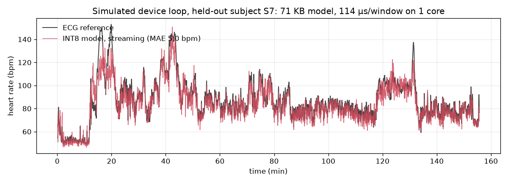
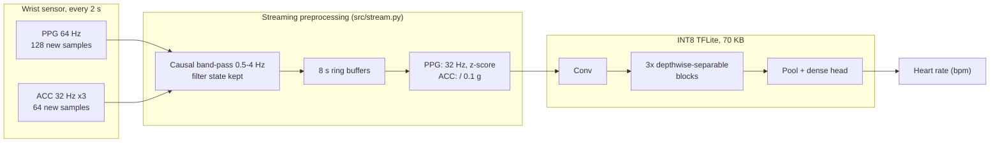

# Edge heart-rate estimation from wrist PPG

[](https://github.com/pescadorpyke-alt/ppg-heart-rate-estimation/actions/workflows/ci.yml)

**A 70 KB INT8 neural network that estimates heart rate every 2 s from a wrist
PPG sensor and accelerometer, evaluated on held-out people with the same
streaming pipeline a wearable would run.**

| | |
|---|---|
| Accuracy (15 held-out subjects, INT8, streaming input) | **9.24 ± 4.83 bpm MAE** |
| Model | 46,753 params, **1.61 M MACs** per window, **70.4 KB** fully-INT8 TFLite |
| Memory | 12.0–55.3 KB activations (lower/upper bound), 5.1 KB streaming state |
| Latency, 1 desktop core (not a device) | 177 µs preprocessing + 114 µs inference per window |
| vs. the original CNN in this repo | same accuracy (9.47 ± 4.94), **7× less compute** |
| vs. classical DSP / predicting the mean | 15.10 ± 6.70 / 18.57 ± 7.68 bpm |

Every number in this repo comes from code in it, run on PPG-DaLiA with
leave-one-subject-out evaluation. Published results are cited with links, never
quoted from memory. Every design choice, with the alternatives and the trade-off,
is in [`DECISIONS.md`](DECISIONS.md) (D1–D23). **Not a medical device**
([`MODEL_CARD.md`](MODEL_CARD.md)).



*Simulated device loop: a held-out subject replayed in 2 s sensor chunks through
the streaming preprocessing and the fully-INT8 model, pinned to one CPU core.
S7 is easier than average (5.0 bpm; the mean over 15 subjects is 9.24).*

> 📷 **Real-device demo: not recorded yet.** There is no hardware in this project
> yet (D1). What a microcontroller or Android build needs, and how to measure it
> there, is in [`docs/DEVICE.md`](docs/DEVICE.md).

---

## How it works



- **Inputs:** wrist PPG (BVP) at 64 Hz and a 3-axis accelerometer at 32 Hz from
  an Empatica E4. The accelerometer tells the model how the arm is moving, since
  motion is what corrupts wrist PPG.
- **Windows:** 8 s, a new one every 2 s, aligned exactly with the dataset's
  ECG-derived labels (64,697 windows from 15 subjects, about 2.5 h each).
- **Training uses the same causal filter as the device**, so what the model sees
  in training is bit-identical to what the streaming code computes (D21, tested
  in `tests/test_preprocessing.py`).

## Results

All results: **leave-one-subject-out over all 15 subjects** (each subject is
tested by a model that never saw them; the next subject in order is used only for
early stopping). Headline = mean ± std of the 15 per-subject MAEs, as in the
dataset paper (D3, D4). Raw numbers: [`results/`](results/).

### 1. Baselines and the original model

| Method | Params | MAE (bpm) |
|---|---|---|
| Predict the mean HR of the other 14 subjects | 0 | 18.57 ± 7.68 |
| Naive FFT peak (original code) | 0 | 18.38 ± 8.09 |
| DSP, built up step by step: zero-padding, 40–200 bpm band, motion-peak rejection, soft tracking | 0 | 15.10–15.78 |
| Original 1D CNN (64 Hz input) | 118,945 | 9.47 ± 4.94 |

- **The original README said the FFT baseline was worse than guessing the mean
  (31.4 vs 23.9 bpm).** Re-running it reproduced those numbers exactly. But they
  came from a 2-subject validation set containing S5, the hardest subject for
  every method. Over all 15 subjects the two are level.
- **Why the naive FFT fails** ([`src/diagnose_fft.py`](src/diagnose_fft.py)): it
  picks the accelerometer frequency in only 8 % of windows, and 45 % of its
  error fits no simple pattern. It is near-perfect while sitting (3.7 bpm) and
  worst on stairs (37.6 bpm).
- The DSP step that made things *worse* (a hard tracking window: 22.31 bpm) is
  kept in the table in D5, with the fact that the fix was designed after seeing it.

### 2. Edge-aware model design

Budget per window (D2): **≤ 5 M MACs, ≤ 256 KB INT8 weights, ≤ 64 KB
activations, ≤ 200 ms**. One change per variant; the variant is **chosen on
validation MAE, never test MAE** (D12).

| Model | Change | Params | MACs | Fits | Val MAE | Test MAE |
|---|---|---|---|---|---|---|
| `cnn_v0` | original, 64 Hz | 118,945 | 11.49 M | no | 8.12 ± 3.76 | 9.47 ± 4.94 |
| `cnn_v0_32hz` | 32 Hz input | 118,945 | 5.75 M | no | 8.41 ± 4.41 | 8.81 ± 4.18 |
| `ds_32hz` | depthwise-separable convs | 46,753 | 1.61 M | yes | 8.49 ± 4.39 | 9.05 ± 4.33 |
| **`ds_32hz_fixed`** | ACC scaled by 0.1 g, not z-scored | 46,753 | **1.61 M** | yes | **8.08 ± 4.05** | **9.00 ± 4.55** |
| `ds_wide_32hz_fixed` | wider channels | 110,641 | 3.80 M | yes | 8.28 ± 4.31 | 9.18 ± 4.79 |

- **All gaps are under 0.5 bpm, which I treat as ties** (one seed per variant).
  So the claim is about cost, not accuracy: **7× fewer MACs, 2.5× fewer params,
  same accuracy.**
- **32 Hz is enough:** the heart-rate band ends at 4 Hz (D9).
- **MACs are not speed:** 7× fewer MACs trained only ~2.5× faster on this CPU;
  depthwise convolutions are memory-bound (D10).
- **Fixed ACC scaling** lets the model see that the wrist is still: sitting
  5.16 → 3.78 bpm, but transitions and table soccer get worse (D11).

### 3. Export and quantization

PyTorch → ONNX → TensorFlow → TFLite ([`src/export.py`](src/export.py), D13,
D17). **Each fold's model is quantized and scored on its own held-out subject**;
INT8 calibration uses only that fold's training subjects (D16).

| Format | MAE (bpm) | File | Median latency, 1 core, 1 thread |
|---|---|---|---|
| PyTorch FP32 | 9.003 ± 4.549 | — | 1,323 µs |
| ONNX Runtime FP32 | 9.003 ± 4.549 | 183.7 KB | 83 µs |
| TFLite FP32 | 9.003 ± 4.549 | 184.4 KB | 57 µs |
| TFLite FP16 | 9.004 ± 4.549 | 98.2 KB | 57 µs |
| **TFLite INT8** | **9.071 ± 4.565** | **70.6 KB** | 83 µs |

*`ds_32hz_fixed`, zero-phase input; TFLite with XNNPACK; Intel i3-10100 desktop
core, so latencies compare formats and are not device latency (D14).*

- **INT8 costs 0.07 bpm**, below a 0.5 bpm threshold committed before the results
  (D15), so quantization-aware training was not needed.
- **INT8 is 2.6× smaller, not faster, on a desktop CPU** with fast float SIMD.
- **Found and fixed: a hidden INT8 ceiling.** Random calibration windows rarely
  had high heart rates, so the INT8 models could not output more than 145–174
  bpm. The average hid it (+0.04 bpm); single cycling windows were 25 bpm off.
  Calibrating evenly across heart rate raised the ceiling to 167–195 bpm (D16).
- **Found and fixed: two export/runtime problems.** 1-D depthwise convs exported
  as slow grouped convs (fixed by a numerically identical 2-D export, D17). The
  `ai_edge_litert` 2.1.2 Windows build never used its fast kernels and ran INT8 in
  ~12 ms (D18). Both stay visible in `results/benchmark_ds_32hz_fixed.csv`.

### 4. Running it like a device

A wearable cannot filter with zero phase as training originally did, because
that needs future samples. [`src/stream.py`](src/stream.py) filters causally as
samples arrive, keeps 8 s ring buffers, and emits a window every 2 s.

| Input pipeline (INT8, 15 subjects) | Model trained on zero-phase input | **Model trained on causal input** |
|---|---|---|
| Offline, as in training | 9.07 ± 4.57 | 9.24 ± 4.83 |
| Per window, zero-phase (the current API) | 9.18 ± 4.56 | 11.75 ± 5.94 |
| **Streaming, causal (a device)** | 11.47 ± 4.88 | **9.24 ± 4.83** |

**The model that looked best offline lost 2.4 bpm on the pipeline a device can
actually run**, and it was worse on all 15 subjects. Under a rule committed before
the measurement (D19), it was retrained on causally filtered input (D21). That is
the shipped model: [`models/`](models/) has INT8 / FP32 TFLite, ONNX, and
`ppg_hr.json` with the exact input spec and quantization parameters. It is the same
recipe trained on all 15 subjects (D20), so its accuracy estimate is the LOSO
number above.

### 5. Comparison with published results on PPG-DaLiA

Copied from the cited papers, not re-run. MAE in bpm, mean ± std over subjects
where given.

| Method | MAE (bpm) | Model size | Source |
|---|---|---|---|
| SpaMaPlus (classical) | 11.06 ± 4.8 | — | Deep PPG, Table 4 |
| Deep PPG resource-constrained CNN | 9.99 ± 5.9 | 26 K params | Deep PPG, Sec. 5 |
| Deep PPG single CNN | 8.82 ± 3.8 | 8.5 M params | Deep PPG, Table 10 |
| Deep PPG ensemble (7 CNNs) | 7.65 ± 4.2 | ≈ 60 M params | Deep PPG, Tables 10, 12 |
| Q-PPG-S, INT4 on STM32WB55 | 7.73 | 1.9 kB | Q-PPG, Table IV |
| Q-PPG-L, INT8 on STM32WB55 | 4.41 | 412 kB | Q-PPG, Table IV |
| **This repo, INT8, streaming input** | **9.24 ± 4.83** | 70.4 KB, 46.8 K params | above |

- **Deep PPG:** A. Reiss, I. Indlekofer, P. Schmidt, K. Van Laerhoven, *Deep PPG:
  Large-Scale Heart Rate Estimation with Convolutional Neural Networks*, Sensors
  19(14):3079, 2019 (the dataset paper).
  [PMC6679242](https://pmc.ncbi.nlm.nih.gov/articles/PMC6679242/)
- **Q-PPG:** A. Burrello et al., *Q-PPG: Energy-Efficient PPG-based Heart Rate
  Monitoring on Wearable Devices*, IEEE TBioCAS 15(6), 2021.
  [arXiv:2203.14907](https://arxiv.org/abs/2203.14907)

**Where it sits:** between Deep PPG's 26 K-parameter and 8.5 M-parameter CNNs,
and clearly behind Q-PPG, which uses neural architecture search and smoothing
across windows. How comparable these are:
- Deep PPG tests per subject like here.
- Q-PPG groups subjects into 4 random folds, and its best-listed 3.61 bpm
  fine-tunes on the test subject, so that row is left out.
- Neither paper evaluates a causal streaming pipeline.

## Reproduce

Two Python 3.12 environments: one for training and the API, one for
TensorFlow-based export (D13).

```bash
# training / API / tests
pip install torch==2.12.1 --index-url https://download.pytorch.org/whl/cpu
pip install -r requirements-dev.txt

# export / quantization / benchmark (separate venv)
pip install torch==2.12.1 --index-url https://download.pytorch.org/whl/cpu
pip install -r requirements-export.txt
```

Data: download [PPG-DaLiA](https://archive.ics.uci.edu/dataset/495/ppg+dalia)
(2.7 GB, CC BY 4.0) and extract it into `<PPG_HEAVY_ROOT>/raw/` (default
`D:\ppg-dalia-hr`; set the `PPG_HEAVY_ROOT` environment variable to change it).

Every step is one CLI command ([`src/cli.py`](src/cli.py); the
[`Makefile`](Makefile) wraps the same commands):

```bash
python -m src.cli --list          # all steps with rough run times
python -m src.cli test lint       # no dataset needed; what CI runs
python -m src.cli data baselines profile loso export stream-eval demo final report
```

`loso` is the long step (2–5 h on a 2-core CPU). It saves every fold, so
`--resume` continues after a crash. The CLI runs TensorFlow steps with the export
environment (`PPG_EXPORT_PYTHON`).

**Tests:** 54 pytest tests that need neither the dataset nor TensorFlow
([`tests/`](tests/)). They cover:
- filter bands;
- streaming == causal training windows;
- model shapes and the edge budget (parameter and MAC counts);
- the 2-D export copy;
- the DSP baseline on synthetic signals;
- INT8 calibration coverage;
- API validation.

CI runs ruff and pytest on every push ([`.github/workflows/ci.yml`](.github/workflows/ci.yml)).

## Repository layout

```
├── src/
│   ├── config.py, preprocessing.py   # constants; load, filter, window, normalise
│   ├── stream.py                     # streaming (causal) preprocessing, as on a device
│   ├── model.py                      # original CNN, depthwise-separable edge CNN, 2-D export copy
│   ├── train.py, loso.py             # training loop; leave-one-subject-out over 15 folds
│   ├── baseline.py, diagnose_fft.py  # constant + DSP baselines; FFT error analysis
│   ├── profile_model.py, report.py   # params / MACs / KB vs budget; README tables
│   ├── export.py, quant_errors.py    # ONNX / TFLite FP32-FP16-INT8 per fold; INT8 error analysis
│   ├── benchmark.py, stream_eval.py  # latency per runtime; accuracy per input pipeline
│   ├── context_eval.py               # how much signal before the window the API needs (D23)
│   ├── device_demo.py                # simulated device loop: timing, memory, plot
│   ├── train_final.py, export_final.py  # deployable model -> models/
│   ├── infer.py, make_example.py     # API inference helpers
│   └── cli.py                        # one command per pipeline step
├── tests/                 # pytest suite (no dataset needed)
├── models/                # deployable model: INT8 / FP32 TFLite, ONNX, ppg_hr.json
├── results/               # every number in this README, as CSV / JSON
├── docs/DEVICE.md         # what is measured; next steps for TFLite Micro and Android
├── api/main.py            # FastAPI inference service
├── deploy/, hf/           # AWS Lambda and Hugging Face Space deployment
├── DECISIONS.md           # D1-D23: each choice, alternatives, trade-off
└── MODEL_CARD.md          # data, intended use, per-subject results, limitations
```

## Inference API

A FastAPI service ([`api/main.py`](api/main.py)) serves the **committed edge model**
(`models/ppg_hr.onnx`) with ONNX Runtime: no PyTorch, and `/health` reports the
model file's SHA-256, so you can check which file is answering.

**Why requests carry extra signal:** the model expects causally filtered input
(D21), and a causal filter needs history. A stateless API has none, so each
request sends **c = 2–60 s of signal before the 8 s window**. The server filters
the whole segment causally and scores the last 8 s. The 2 s minimum was measured,
by a rule committed beforehand (D23):

| Context before the window | 0 s | **2 s** | 8 s | 30 s |
|---|---|---|---|---|
| MAE vs full streaming (bpm) | +0.13 | **−0.003** | 0.000 | 0.000 |

```bash
uvicorn api.main:app --port 8000
curl -X POST http://127.0.0.1:8000/predict \
  -H "Content-Type: application/json" -d @api/example_payload.json
# -> {"heart_rate_bpm":84.0,"context_s":2,"model":"ds_32hz_fixed_causal","model_loso_mae_bpm":9.22}
```

The example (S4, window 1500) has an ECG reference of 98.5 bpm. It is one window
from a subject the served model was trained on: a demo, not an accuracy result.

`POST /predict`:
- `ppg`: 64 × (8 + c) raw PPG samples (64 Hz).
- `acc`: 32 × (8 + c) rows of [x, y, z] in g (32 Hz), covering the same seconds.

Requests are rejected with HTTP 422 when:
- the context is shorter than 2 s or longer than 60 s, or not a whole number of
  seconds;
- `ppg` and `acc` cover different durations;
- any value is NaN or Infinity.

The NaN check also fixed a crash in FastAPI's default error response (covered by
tests).

**Live demo:** [pescas-ppg-heart-rate.hf.space/docs](https://pescas-ppg-heart-rate.hf.space/docs)
**still runs the original model and request format** until the Space is
redeployed with this version. [`hf/Dockerfile`](hf/Dockerfile) is ready, but no
Docker image has been built from it yet. The same app also deploys to AWS Lambda
([`deploy/README.md`](deploy/README.md); not currently provisioned).

## Limitations

Summarised here; per-subject results and risks are in
[`MODEL_CARD.md`](MODEL_CARD.md).

- **Large differences between people.** One subject is at 22 bpm and four
  others are above 13 bpm. Motion (stairs, table soccer, cycling, walking) is
  3.3–5.4× worse than sitting.
- **Narrow population:** 15 adults, one wrist device, Fitzpatrick skin types 2–4
  only.
- **No real device yet.** Latency and memory are desktop measurements (D1, D14).
- **High heart rates:** the INT8 model cannot output above 177.4 bpm and
  under-predicts very high rates (D16).
- **No smoothing across windows.**
- **The live Hugging Face demo still runs the old model** until it is redeployed
  (the API code in this repo serves the edge model).
- **Not state-of-the-art:** the best published results are clearly better. The
  goal is a small model that fits an edge budget, evaluated honestly.
